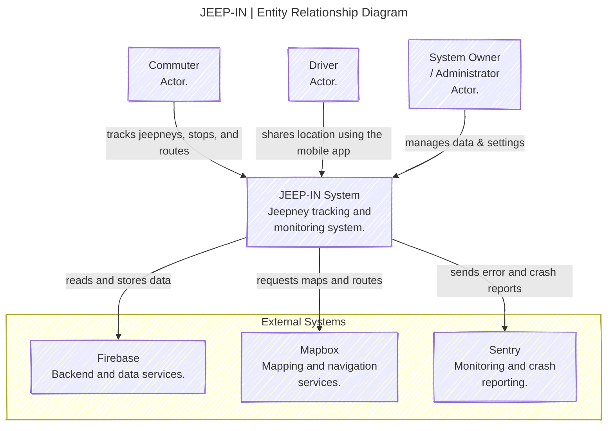
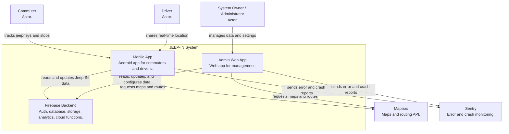
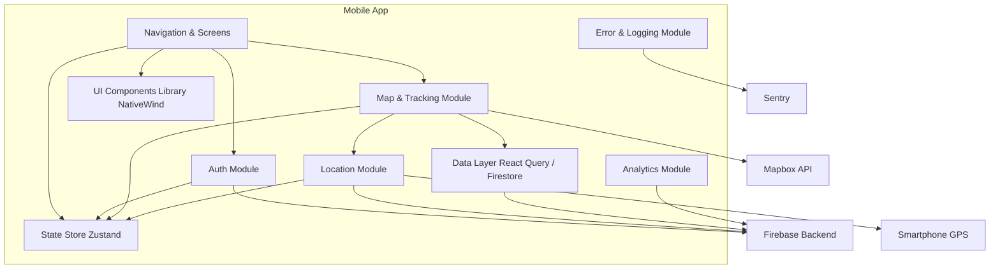
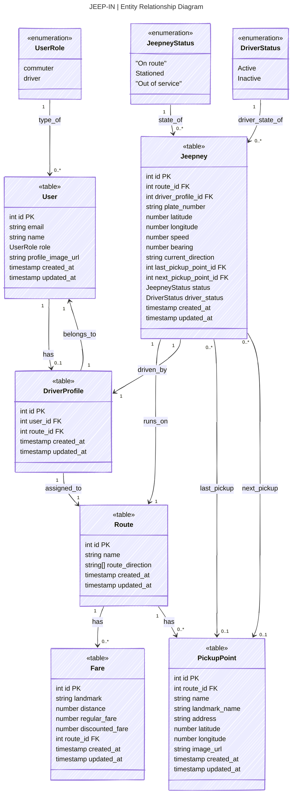

# JEEP-IN: A TRACKING SYSTEM FOR MODERN JEEPNEYS IN ILOCOS NORTE

**Capstone Project**  
_In partial fulfillment of the requirements for the degree of Bachelor of Science in Information Technology._

## Project Description

**JEEP-IN** is a mobile-based real-time tracking system built to modernize public transportation in Ilocos Norte by leveraging GPS. This system improves visibility, route clarity, and commuter convenience by allowing passengers to track jeepneys, view stop points, and access relevant route data.

The app supports 2 roles: **Commuter** and **Driver**, each with tailored dashboards and features.

## Developer

- Bryan Jesus B. Mangapit

## Core Features

### Commuter Features

- Live jeepneys for the direction you pick, sorted by minutes to your stop
- Nearest stop from your location, or a stop you choose when location is off
- Stop search by name, address or landmark, with stop details
- Fare for your trip from the posted LTFRB matrix, with the student / senior discount
- "Notify me at 3 min" arrival alerts, kept on the phone only
- Last known positions and offline fares when there is no signal
- Light, dark or match-phone appearance and three text sizes

### Driver Features

- One switch to share location, confirmed only once commuters can actually see it
- Sharing follows the shift hours and stops by itself at the end, with optional extra time
- Direction switch, with a prompt at the end of the route
- Report a problem to the manager in one tap
- Direction and Report lock while the jeep is moving

## Tech Stack

- **Frontend:** React Native + Expo
- **Authentication:** Firebase Authentication
- **Database:** Firebase Firestore
- **Location & Maps:** Mapbox SDK
- **State Management:** Zustand, Tanstack Query, Expo Secure Store
- **Navigation:** Expo Router

## Architectural Highlights

- Clean role-based layouts via folder routing
- Firebase modular SDK for scalable backend logic
- Design tokens shared between Tailwind (CSS variables) and JS, switching with the Appearance setting
- Arrival times measured along the route path, so no Directions API call per jeep

## Firestore Data Model

Older documents still load: missing fields fall back to defaults, and `stop_points.routeDirection` and string `routes.directions` are read as before.

| Collection         | Fields                                                                                                                                                                                                                                 |
| ------------------ | -------------------------------------------------------------------------------------------------------------------------------------------------------------------------------------------------------------------------------------- |
| `routes`           | `name`, `vehicleClass`, `isActive`, `workingHours { start, end }` ("HH:mm"), `averageSpeedKph`, `directions[] { id, label, via[], path[] { lat, lng } }`. Without `path`, the road is traced through the stops with Mapbox Directions. |
| `stop_points`      | `name`, `address`, `landmark`, `description`, `amenities[]`, `photoUrl`, `routeId`, `directionId`, `order`, `distanceKm` (from the first stop, for fares), `lat`, `long`, `isActive`                                                   |
| `fare_matrices`    | `routeId`, `vehicleClass`, `orderNo`, `issuedBy`, `effectiveDate`, `baseFare`, `baseKm`, `perKm`, `discountRate`, `roundTo`. Without a document, placeholder rates are shown and labelled as such.                                     |
| `jeepneys`         | `plateNumber`, `jeepneyNumber`, `routeId`, `assignedDriverId`, `status`, `seats`                                                                                                                                                       |
| `drivers`          | `name`, `employeeId`, `role` (`main` / `reliever`), `phone`, `licenseNo`, `licenseExpiry`, `photoUrl`                                                                                                                                  |
| `driver_locations` | `driverId`, `lat`, `long`, `heading`, `speed`, `directionId`, `isSharing`, `updatedAt` (server time), `overtimeUntil`                                                                                                                  |
| `driver_reports`   | `driverId`, `jeepneyId`, `unit`, `reason`, `note`, `lat`, `long`, `directionId`, `status` (`sent` / `withdrawn`), `createdAt`                                                                                                          |

## Setup & Installation

### Clone the Repository

```bash
git clone https://github.com/bruhhhyannnn/JEEP-IN.git
cd JEEP-IN
```

### **Install Dependencies**

```bash
npm install
```

### **Start the App**

```bash
npx expo start
```

## Notes

- Ensure your .env file is properly configured with your Firebase and Mapbox credentials.
- Mapbox API is used for custom map rendering and routing.
- Future updates will include background location tracking for drivers, admin data analytics, and trip history features.

---

Crafted with care by:

- Abijah Mcguiller B. Barruga
- Bryan Jesus B. Mangapit
- Mark Neilsen B. Paguirigan

MMSU | Bachelor of Science in Information Technology

---

## C4 Model Diagram

##### System Context Diagram



##### Container Diagram



##### Component Diagram



---

## UML Use-Case Diagram

```mermaid
---
title: JEEP-IN | UML Use-Case Diagram
config:
  theme: default
  look: handDrawn
---

```

---

## Entity Relationship Diagram


